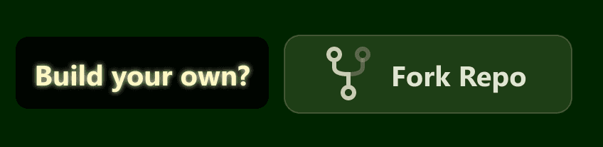
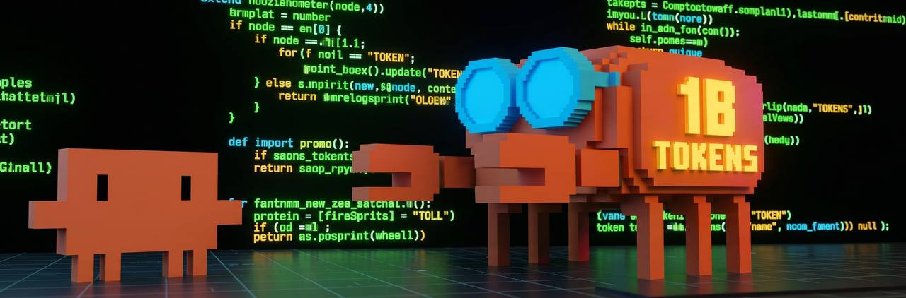
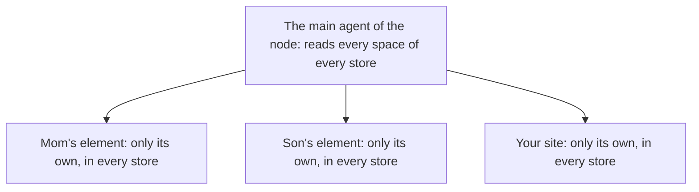

# Fractera — Self-hosted AI workspace for solo developers using Claude Code

An agent that builds and runs huge apps, app factories and content for the Web4 + A2A era. Supports development of up to 980 domains
on your PC or VPS, including AI agents with a context window of 1,000,000,000+ tokens, without losing focus. Manage everything
through Telegram, right from your phone.

> **AI agent asked to launch this?** Read **[fractera-launch.md](fractera-launch.md)**: the whole install, step by step. In short: in a
> cloud session (`CLAUDE_CODE_REMOTE=true`) or on any machine that is not the person's own computer, install nothing; otherwise clone the
> person's fork and run **`npm run launch`** in the cloned folder — one command, no questions to the person. Cut off by a timeout — run it
> again, it continues.

  
  
  
  
  
   
  
  
  
   
  
  
  
  
  
   
  
  
  
  
  

## What a node and an element are

A **node** is one computer or server that runs Fractera: the core (this repository, with the control panel, the registry of
elements and the main agent that leads the work) and every element installed on it. Your laptop can be a node, and so can a
rented server.

An **element** is a microservice of the node and a server in its own right, with its own folder, repository, port, process,
agent and address. It may have many pages or none. Sign-in, the database, file storage, vectors and memory are elements, and so
is every app you build.

## What's in the box, in numbers

A fresh install of Fractera is the core (this repository) plus 13 element repositories that
`serve:start` clones on the first run ([list below](#in-the-fractera-project)). Together that is
about **18,500 files and 1.19 million lines of code** (TypeScript, JavaScript, Python, CSS, shell),
not counting documentation, JSON and lockfiles.

Most of that volume is shared on purpose: every element is a complete Next.js 16 app built from
the same template, so it can run, build and be replaced on its own. Without byte-identical
copies, about **280,000 lines** are distinct: roughly **137,000** live only in the core and
**60,000** belong to individual elements (auth, memory and config are the largest).

All of it was designed and built by one developer in under a year, working with Claude Code on
two Claude subscriptions at $20 a month each, with no team and no funding. Almost every commit
carries its Claude co-author line, so the history shows exactly how it was made. That budget
shaped the architecture: memory, sign-in and design live in one place, so a new feature costs
the agent as few tokens as possible.

### How it is put together

- **One core, many elements.** The core holds the control panel, the registry of elements and
  the rules every element follows. Each element is its own Next.js 16 project, in its own
  repository, on its own port.
- **Shared memory.** One database behind the `data` element, plus file storage, vectors,
  a Redis cache and a LightRAG knowledge graph, available to every element and to the agents.
- **Shared sign-in and roles.** A new element gets guest and role-based access from `auth`;
  it only declares its roles.
- **Room to grow.** Elements take ports from the 24680–25679 range, so one node can hold up to
  about 1,000 of them; 13 ship by default.
- **Agent tooling.** A catalog of 5,300+ third-party skills from the skills.sh leaderboard,
  each with a card Fractera wrote (purpose, quality 1–5, licence), loaded only when a task needs
  it; 108 design skills; up to 82 languages.
- **Product questionnaires.** A documentation and questionnaire flow that turns an element into
  a product specification step by step.

### Status

Fractera works today on a regular Web2 stack (Next.js, SQLite, Cloudflare). Agent-to-agent (A2A)
features, what this project calls Web4, are in development. Contributors are welcome.

  

Reverse-engineer any popular product and build your own: a starter kit for a large full-stack app or an app factory, on your PC
or a VPS. Sign-in, data, files, memory and a knowledge graph come ready, and every element designs its own pages. Work from
Telegram by voice. On the way with the Lagrix network: blockchain payments, agent discovery, fair rating. Open source, MIT.

You describe what you want in your own words. The agent of your node builds it for you.

## Six things people build with it

### 1. A large full-stack app

From idea to money 99% faster. Sign-in, data, files and settings are already in the node, so the agent builds only your product:
the screens, the logic and the texts that make it yours. Each element's agent designs its own pages from your brief (who it is for,
a few words about its character, references, what to avoid). Payments by card go through the node's Stripe element with one call.

### 2. An app factory

Make your own versions of popular products. The node studies how they work with reverse engineering and builds yours on their
ideas, never on their code, texts or pictures. One node carries many independent sites and apps at once, each with its own address,
agent and repository. How many depends only on your computer.

### 3. Web4: a swarm of A2A agents (on the way)

Inside one node this works today: the agents of your elements find each other and agree on an API (i2i). The step outside is being
built: with the [Lagrix](https://lagrix.dev) network, the agents of other nodes will find yours, agree on the work and pay for it,
with no platform in between, and a rating will count only real paid work. Until the network launches, the node hides its Lagrix
pages; every element already carries an A2A card (`/.well-known/agent-card.json`), so nothing has to be rebuilt when it comes.

### 4. Agents for a family or a team

One architect gives every person an element of their own. A person creates a Telegram bot and simply talks to the agent, never opening
the computer. Each works on their own Claude subscription, and each element keeps its own memory, data and people.

### 5. A content factory

A channel element for every platform you publish on, an element of author portraits, and posts written in the voices of the authors
you admire. Each channel reads the numbers of its publications back and learns what works on its platform, and a scout watches social
networks, Telegram channels, YouTube and the news to catch a topic while it rises. Nothing is published without your yes.

### 6. Your own agents

A coach, a dietitian, an economist, an investor, a keeper of the dates you must not miss: a tax return, a car's service. Say in
Telegram what you need; the agent looks for the best way, proposes it, and then works in the chat or on a page of its own, on the
node's deep memory and stores. It is not a doctor or a licensed adviser, and it says so.

## Killer features

### 108 design skills compete for your element

Fractera keeps 108 design skills by third-party developers, each with a link to its GitHub repository. Pick a few for an element, show
a screenshot or a link of a site you like, and each skill builds its own test page of that element in about ten minutes. You flip
through the results, fine-tune the one that wins and approve it: its colours, fonts and shapes become the element's design, and the
agent builds every other page in it. The whole path works from Telegram. A family of elements can share one look, or each can keep its
own.

### A tuning studio for your AI agent: a billion tokens of context

No model today has a context window of a billion tokens, and a node gets there another way. Every element works in its own Claude
Code window of up to a million tokens, and its steps, memory and development diary carry the work from session to session, so tens
or hundreds of projects grow side by side. Compaction is off: past 55% of a window the agent writes a letter to its next session, and
the node starts a clean one from it. The elements last and agree an API once, so nothing is read twice; a swarm of short-lived
subagents spends about fifteen times the tokens of a chat, by Anthropic's own measure.

### Reverse engineering and the product quiz: one cycle

Name a popular site or SDK, and the node studies how it works: its pages, user flows, API and data. It handles sites, npm and Python
packages, .NET and native libraries, Android apps and WASM. The study is done by [REA](https://github.com/morluto/rea), an open
tool the core keeps one copy of; the element's own agent runs it, and the study stays in that element's folder. The node takes ideas
and structure and never copies foreign code, texts, pictures or design. If a site's rules forbid a study, you show it with
screenshots, and the node studies similar sites whose rules allow it.

Then the product quiz puts your product into plain words before any code. The element's agent asks one question at a time: who the
product is for, what it does, what it needs. It checks what the node already has and suggests a study where one helps, with its price.
The quiz turns into stages: stage 0 is static pages with first data, and each next stage adds one capability that works on its own.

### Deep memory and a curious soul

Say «remember…» to the main agent in your own words, in any language, in Telegram or in the terminal, and add a photo, a PDF or a
voice note if you like («remember, this is my mom»). Ask «remind me about…» a month or a year later, and the answer comes with the
date, the source and how sure the memory is; if it finds a thing, the agent sends you its file. Pictures are described in words, PDFs
are read whole, voice notes become text.

Each element keeps only its own, in every store of the node: its tables, files, vectors, graph and memory, opened with its own key.
What is said or kept through an element lands in that element's space, and only that element finds it again; the main agent of the
node reads every space. On a family node mom's phrases and files never reach her son's element, and the architect, who owns the
computer, sees everything. The stores keep the doors apart, not the disk: all elements run as one user of the computer.

Before it builds something new, an agent looks in the node's skills base and in the catalog below for how other projects solved the
same task. The base comes with every copy of the node, and each skill keeps its own licence. The agent mixes what it finds with its own
reasoning, says it in its own words and names whose skill it was.

### 5,300 ready skills, no tokens until one is needed

Every node comes with more than 5,300 of the most popular agent skills of 2026, the top 6,000 of the skills.sh leaderboard. Fractera
read each one and wrote it a card: what it does, how useful it is for a node, whether it works as written, needs an outside service or
is worth only its ideas, a quality mark from 1 to 5, its scripts, its licence and the security audits of skills.sh partners. The cards
stay out of the agents' context and cost no tokens until a task needs them.

When a task comes, the agent searches the cards by meaning — in any language, on your computer, in a few hundredths of a second — and
reads the few skills that fit, so it starts from the ways other projects already solved the same task and reasons with them. The
catalog arrives as one ready file (about 25 MB) with every install and update: nothing is marked or counted on your computer. A skill
is installed only into the element that needs it, never into the whole project, and only after your «yes»; Fractera keeps a checked
copy of every skill whose licence allows it, so a skill that disappears from GitHub stays available and a changed one is refused. A
skill with scripts waits for a separate «yes», a skill with a risk is never offered, and the open skills.sh is looked at only when
you ask for it.

Tell the agent which sources of skills to watch and how often, and after your «yes» it adds fresh ones on that schedule: each new skill
is marked, laid into the knowledge graph and left alone until a task needs it. Found a skill yourself? Name it or send its link, and
the agent finds it, checks it and adds it to the library.

### Continuous evolution

At first an agent may see a task its own way. Tell it what result you need, and it keeps that in memory or in a skill and next time
does it your way. When an element finishes a task, it can review its own session and suggest up to three changes to its skills; it
makes only the ones you accept. An element that lacks a capability asks the node: the main agent looks for someone who can already do
it, and if nobody can, it asks you and, after your «yes», leads the building.

### Many times less work for the model

The project is split into elements, and an agent reads only its own element and its own instruction, not the whole code. Sign-in,
data, files, settings and ready solutions are already built and shared, so the agent connects them instead of writing them
again. Elements agree with each other through an API (i2i), without extra requests to the model.

### Click, say, accept

Click a section in the preview, say what to change, and the task goes to that element's agent. Every change is first built in a
preview, and you accept it with one button, so the live version never breaks. Every element lives in its own GitHub repository, with
history and rollback at hand.

### You do not have to open the panel

Connect your Telegram and tell it what you want to build. You can stay on your phone the whole time and build large projects that
anyone can open by a link. One Claude Pro subscription ($20 a month) runs the whole node; search by meaning and the skills base
work on your computer with no key; an OpenAI key, kept on your computer, adds voice notes and translations.

## It runs on your computer as a real server

The node runs in production on your own computer: pages are pre-built and open in milliseconds. The first start puts it on the
internet by itself, at a temporary Cloudflare address. When the computer is off, Cloudflare keeps answering: it returns the latest
version of your site or app as static pages from your own Cloudflare account, on the free plan.

**Use it with your own domain.** The copy that answers while the computer sleeps lives on your domain and its subdomains, sign-in
works only there, and the address never changes.

## Launch your own server whenever you want

You can start on your own computer and later run the node on your own Ubuntu server, where it works around the clock while
your computer is off. In the panel, «Domain and hosting» → «A dedicated server», you give the server's IP address and root
password, and the node does the rest in seven steps without a model: it checks the server, connects your domain, installs a
fresh node from your fork, points the DNS records at it, issues the certificates and switches sign-in on.

Domains, subdomains and certificates are the node's job. Every element gets its own subdomain with a certificate; when you
rename or delete an element, its name follows it or goes away. A launch never stops or changes your computer, and you can
launch a second server, or a tenth, the same way. Each server starts as a fresh node with its own keys and accounts, and the
data on your computer stays on your computer.

## Updates and rollbacks

Fractera keeps developing the core and the elements. When a new version comes out, a banner in your panel says so and takes
you through it in two moves: sync your fork on GitHub (the main agent can do it for you), then «Update the core build», which
opens the Deployments tab. There the node takes the changes from your fork, moves every element to its new version and
rebuilds. If the core's build fails, the previous version comes back and keeps serving.

If an element misbehaves after an update, or you do not like the change, open its «Deployments» page and press «Roll back to
a version». Any earlier version from its history comes back as a new commit with no downtime, and you can return to the current
one the same way. A rollback changes the element's code; its database stays as it is.

## Made for a personal brand

One person rarely does one thing. A node lets you run a site for each direction, a coach page, a shop, a blog, a portfolio, side by
side, under one domain, and gives each of them the technical part that search and social networks expect:

- static pages that search engines read without JavaScript, with a sitemap, robots rules and language alternates;
- `llms.txt` for AI search, and a preview image for every shared link;
- Google Analytics and Search Console from the settings, with a cookie banner when they need one;
- up to 82 languages, and you choose which of them search engines see;
- review pages and a Telegram bot of your own.

  

## How to install

> [!IMPORTANT]
> **A computer with 8 GB of memory: the first install may take about 30 minutes.** Building the node's core needs about 14–15 GB of
> memory and swap together — two builds measured on an 8 GB Linux server on 2026-11-13 peaked at 13.6 and 14.8 GiB. With less
> memory the system moves the rest to disk (the page file on Windows, swap on macOS and Linux), so the build slows down but does not
> break. Let it run and keep the terminal open. On a Linux server the node adds the swap it needs by itself (memory plus swap of at
> least 24 GB).

1. **Install Claude Code.** One line in a terminal, from [code.claude.com/docs/en/setup](https://code.claude.com/docs/en/setup):
   `curl -fsSL https://claude.ai/install.sh | bash` on macOS and Linux, `irm https://claude.ai/install.ps1 | iex` in Windows
   PowerShell. You need the Pro plan or higher ($20 a month), which includes Claude Code.
2. **Install Telegram and sign in** — on your phone or computer, from [telegram.org/apps](https://telegram.org/apps). The node
   talks to you through your own Telegram bot; without the app no bot can be made, and its pages lead to errors.
3. **Fork this repository.** Create a free GitHub account, press **Fork** at the top right of this page and copy the address of
   your copy. Only your own direct fork of `github.com/Fractera/web4-node-starter-kit` installs: a clone of the original, a fork
   of someone else's fork or any other copy is refused with «You are trying to install a non-original Fractera project».
4. **Make an empty folder for the project, open a terminal in it and run `claude`.** The node is installed into exactly this
   folder, so name it the way you want to see it.
5. **Paste the link to your fork and write «launch this»** (in Russian: «запусти это»).
6. **Wait 10–25 minutes and watch the stages.** The agent tells you each of about twenty stages as it goes — the packages, the
   build, every element of the node, the temporary Cloudflare address. At the end it gives you what matters now: your Claude Code
   subscription, Telegram, the bot, the terminal, the temporary public link and your own domain — and says goodbye.
7. **Close the installation chat.** The node runs by itself and the chat only takes memory. From then on your own main agent
   works with you — in the node's terminal or, mostly, in Telegram, by text or by voice.
8. **Later, buy your own domain** and connect it on the node page «Domain and hosting → Domain activation».

Two rules: Claude Code must run on **your** computer (a cloud session installs into a machine that disappears, so the install
refuses there), and there is **one node per computer**: new sites and apps are elements inside it, created with «Create WEB4 ITEM».

See a live node: **[throughsongs.com](https://throughsongs.com)**.

## What this template gives you

- **A light public page** — a clean, ready-to-edit starting point.
- **Auth-ready, role-aware out of the box.** The starter integrates with Fractera's shared auth
  substrate and gates pages by role. Access tiers it enforces today: **`guest` → `user` → `architect`**
  (the architect is the owner / top tier).
- **A demo dashboard** that changes real project state (the included example manages products), built on
  typed, reusable route patterns — the seed an AI uses to grow your app further.

### The full role model

The project recognises a complete set of roles, so you can grow role-specific experiences without
inventing the access model yourself:

| Group | Roles |
|---|---|
| **Access tiers** (enforced) | `guest` · `user` · `architect` |
| **Customer-facing** | `buyer` · `vip_user` · `subscriber_lite` · `subscriber_standard` · `subscriber_max` |
| **Staff / operations** | `manager` · `senior_manager` · `support_manager` · `delivery_manager` · `finance` · `content_editor` |
| **Admin** | `admin` |

### Designed for role-based dashboards

Because the role model and the dashboard patterns are already in place, an AI assistant can scaffold
interactive, per-role experiences for you — for example:

- **Buyer / user** — add items to a cart, simulate checkout, chat with a manager, track delivery, leave a review.
- **Architect / admin** — manage the product catalogue, assign customers to managers.
- **Finance (accountant)** — confirm simulated payments.
- **Manager** — view requests from their own customers, message the customer.
- **Delivery** — view and confirm delivery.

These ready patterns let today's AI models adapt to your app's conventions and extend it to any level you
need **using a fraction of the tokens** — saving tens of millions of tokens over building from scratch,
and, more importantly, giving you an expert-grade architecture that scales at minimal token cost.

## Equal starting rights

This starter is open source under the MIT license and gives the same starting rights to Fractera, Inc. and to any other company.
Fractera, Inc. commits to publishing the latest versions of this starter in this repository, so that competition stays fair in the
future too, for as long as Fractera continues developing it.

## In the Fractera project

This repository is the core of a node. Your fork is yours; the core is not an element and is never replaced. A change here changes the
frame of every element (menu, element pages, installation), so make it with Claude Code in the core folder and keep the laws in
`CLAUDE.md`. It shows after `npm run serve:rebuild` (8 to 12 minutes, the node's processes stop for that time and Cloudflare serves
copies of the pages). Fractera's own changes reach your fork when you sync it with this repository on GitHub.

The other repositories of the project and what they do:

| Repository | Role in the node |
|---|---|
| `Fractera/fractera-auth-starter` | sign-in, roles and the users of the node (built-in element `auth`) |
| `Fractera/fractera-data-starter` | the database; the only door to stored data (built-in `data`) |
| `Fractera/fractera-storage-starter` | files: pictures, videos, documents (built-in `storage`, through `data`) |
| `Fractera/fractera-vectors-starter` | vectors and similarity search (built-in `vectors`, through `data`) |
| `Fractera/fractera-embeddings-starter` | the node's own vectors: texts into 384 numbers on this computer, no key (built-in `embeddings`) |
| `Fractera/fractera-graph-lightrag-starter` | the knowledge graph (built-in `graph`) |
| `Fractera/fractera-memory-starter` | the deep memory: «remember» and «remind me about» (built-in `memory`) |
| `Fractera/fractera-config-starter` | project settings, menu, node mode (built-in `config`) |
| `Fractera/fractera-redis-cache-starter` | the fast store for counters and queues (built-in `cache`) |
| `Fractera/fractera-stripe-starter` | card payments through the owner's Stripe account (built-in `stripe`) |
| `Fractera/fractera-root-starter` | the repository of the custom element `root`, an ordinary custom element |
| `Fractera/fractera-custom-item-starter` | the template every new custom element is born from |
| `Fractera/fractera-native-item-starter` | the template of native elements |

Every element repository has a section like this one: what it does, whether you can change it, how, and how the change is used. 
